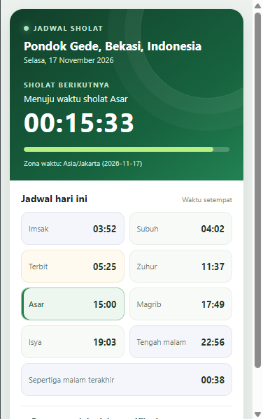

# Jadwal Sholat Akurat

Chrome extension Manifest V3 for displaying local prayer times, sunrise, Imsak, midnight, the final third of the night, a countdown, and optional prayer notifications.

## Screenshot



## Install for development

1. Open `chrome://extensions` in Chrome and enable **Developer mode**.
2. Select **Load unpacked** and choose this project folder.
3. Open the extension popup, select a location and calculation settings, then save.

Prayer schedules are retrieved from the Aladhan API. The location text is sent to that service over HTTPS; the selected preferences and cached schedules are stored in the browser's extension storage.

## Settings

- Location/address used to retrieve the schedule.
- All listed Aladhan calculation methods (Kementerian Agama RI is the default); Dubai method is marked experimental.
- Shafaq option for the Moonsighting Committee method.
- Midnight calculation mode: Standard (midpoint from sunset to sunrise) or Jafari (midpoint from sunset to Fajr). This changes the displayed midnight time, not prayer times.
- Asar calculation school.
- Prayer notifications and an optional 5-, 10-, or 15-minute reminder.

Times and notifications use the timezone returned for the requested location. Notification alarms are recreated when Chrome starts and when settings or schedules are refreshed. A late notification is sent only within the 10-minute catch-up window. When the API is unavailable, the extension keeps a matching cached schedule and retries with exponential backoff up to six hours.

When the extension is pinned to the toolbar, its badge shows a compact countdown and the icon's progress bar shows progress to the next prayer. The badge and icon update every minute; hover over the icon for the full countdown and prayer name.

## Tests

Run the built-in Node.js tests from the project folder:

```powershell
node --test
```
